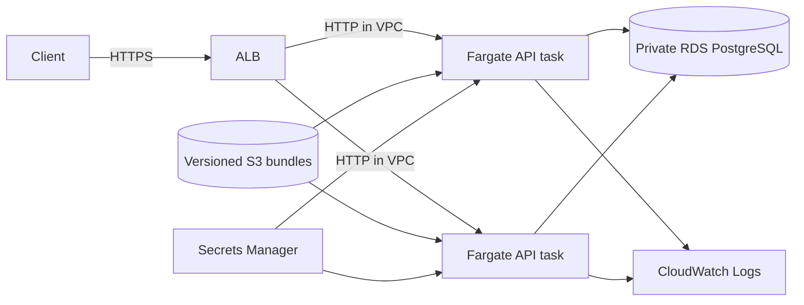

# Reference architecture

ECS runs one API process per task. The ALB target group uses the routability
health endpoint. Each process verifies its checksum-addressed bundle before
startup, maintains a local cache, and polls the shared config pointer. The
pointer and prepared-bundle acknowledgements are PostgreSQL rows. An accepted
mutation receives a revision and signed audit record. Fleet convergence is
tracked separately. Ranking pins the config for the life of the request.

The serving strategy stays `rule-v1`. The labeled rule-only routing fixture
exercises shadow and canary transport. PostgreSQL records impressions,
decisions, and pending outbox events in one transaction. The outbox consumer
delivers after the request boundary. Scoring isolation is exercised with
labeled fault fixtures and the Playground comparison.

Cloud resources are defined in [the CDK app](../infra/stage4.cjs).
Recovery and release procedures are in the [runbooks](runbooks.md).
